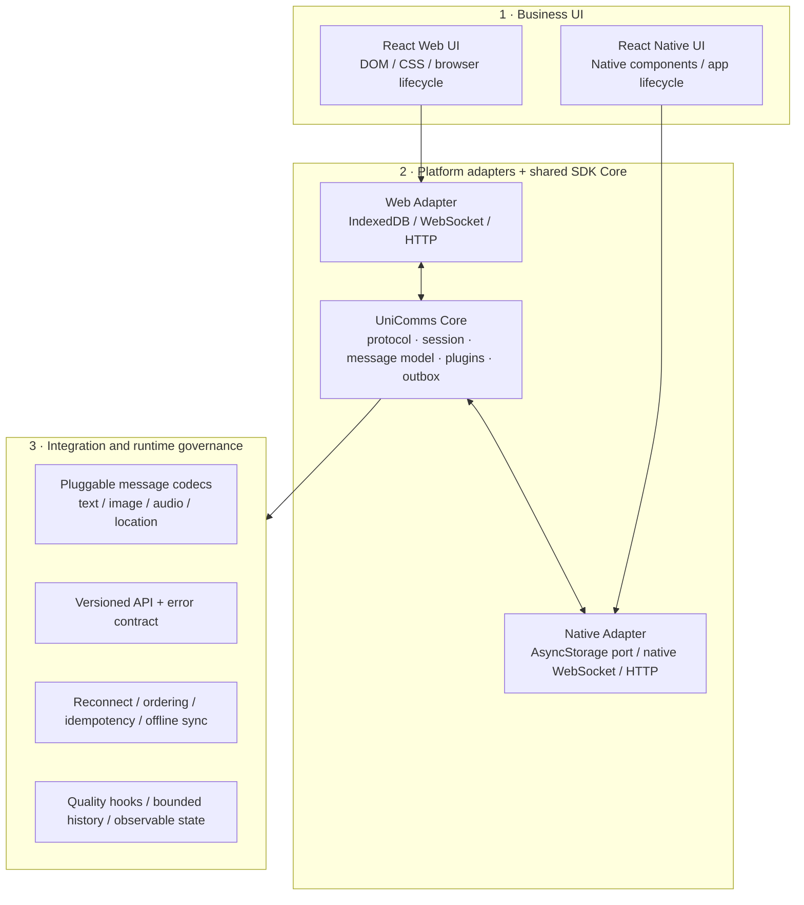

# UniComms-SDK

An open-source reference IM SDK focused on portable protocol/session logic and platform-owned UI. The Web demo is React + TypeScript; `@unicomms/adapter-native` exposes the same runtime ports for React Native without pulling React Native packages into the protocol core.

## Architecture



UI is intentionally platform-specific. Web does not export DOM components to RN. Shared Core owns protocol state, message schema, delivery queue, history reconciliation and plugin validation. Adapters own storage, WebSocket, timers and HTTP.

## Message send sequence

```mermaid
sequenceDiagram
  participant UI as React UI
  participant SDK as IMSDK Core
  participant Store as Adapter storage
  participant WS as WebSocket
  participant API as comms-server
  participant DB as MySQL
  UI->>SDK: send(conversationId, kind, payload)
  SDK->>SDK: validate plugin + assign clientMessageId
  SDK->>Store: persist outbox (before optimistic display)
  SDK-->>UI: queued message
  SDK->>WS: message.send (requestId, clientMessageId)
  WS->>API: authenticate token + validate frame
  API->>DB: lock conversation; dedupe; insert message + outbox in one transaction
  DB-->>API: commit sequence + message
  API-->>WS: ack(requestId, message)
  WS-->>SDK: ack
  SDK->>Store: remove outbox + persist confirmed snapshot
  API-->>WS: message.created to conversation members
  WS-->>SDK: event (other clients)
```

## Quick start

Requirements: Node.js 20+, pnpm 10+, Docker Engine with Compose. From this repository's parent directory:

```sh
cd comms-server
docker compose up --build -d
cd ../UniComms-SDK
pnpm install
pnpm dev
```

Open `http://127.0.0.1:5173`. Register two accounts under the same tenant and create a conversation. The compose file binds MySQL and the API to loopback only. Local demo registration is enabled by Compose; the server's default profile keeps it disabled.

## Initialize the SDK

```ts
import { UniCommsClient, createDefaultPlugins } from "@unicomms/core";
import { BrowserTransport, HttpApi, IndexedDbStorage, browserTimers } from "@unicomms/adapter-web";

const client = new UniCommsClient({
  user, token, websocketUrl: "ws://127.0.0.1:8080/ws",
  api: new HttpApi("http://127.0.0.1:8080", () => token),
  transport: new BrowserTransport(),
  storage: new IndexedDbStorage(`${user.tenant}:${user.id}`),
  timers: browserTimers, plugins: createDefaultPlugins(),
});
await client.connect();
const unsubscribe = client.subscribe(event => { /* update your app state */ });
await client.send(conversationId, "text", { text: "Hello" });
// On logout/unmount:
unsubscribe(); await client.close();
```

### React Native adapter

Core has no native dependency. Supply the native `WebSocket` constructor and an AsyncStorage-compatible key/value implementation:

```ts
import { NativeTransport, adaptNativeWebSocket, AsyncStorageAdapter, NativeHttpApi, createNativeTimers } from "@unicomms/adapter-native";
const adapter = {
  transport: new NativeTransport(url => adaptNativeWebSocket(new WebSocket(url))),
  storage: new AsyncStorageAdapter(AsyncStorage, `${tenant}:${user.id}`),
  api: new NativeHttpApi(apiBaseUrl, () => token),
  timers: createNativeTimers(Date.now, () => /* platform UUID provider */ crypto.randomUUID()),
};
```

The host app should connect on foreground, disconnect or suspend heartbeat according to its background policy, and register its own push/native UI integrations. This package does not pretend to implement APNs/FCM or a native call layer.

## Package map

- `packages/core`: platform-neutral SDK, message codec registry, session state, delivery outbox, history sync.
- `packages/adapter-web`: browser WebSocket, IndexedDB and HTTP ports.
- `packages/adapter-native`: structural RN ports; native storage/socket implementations are injected by the host application.
- `packages/react-ui`: sample React chat surface; can be replaced by product UI.
- `apps/web`: local demo, account auth and conversation bootstrap.

## Runtime behavior and boundaries

- Client message IDs are stable across reconnect/retry. The server enforces `(conversation, sender, clientMessageId)` uniqueness and rejects reuse with a different body.
- WebSocket `ack` is sent only after the DB transaction commits. Events are best-effort online fan-out; REST history is the durable recovery source.
- Sequence numbers are conversation-scoped. History uses exclusive `after` / `before` cursors and pages of at most 200.
- Browser outbox/snapshots are namespaced by tenant and user. Do not place session tokens in the SDK message store.
- This reference server is single-instance: live socket sessions and outbox dispatch are in process. Multi-node deployment needs a shared event broker and outbox claim/lease semantics before horizontal scaling.
- `60fps` and high-volume capacity are not claimed here. Measure on target devices with realistic workloads before making performance claims.

## Design references

The reliability contract follows established IM SDK patterns: client-generated transaction IDs make retransmission idempotent, and reconnect recovery combines queued offline work with server-side event/history reconciliation. See the [Matrix client-server transaction ID rules](https://spec.matrix.org/v1.18/client-server-api/#transaction-identifiers) and [Stream's offline support documentation](https://getstream.io/chat/docs/sdk/ios/basics/offline-support/). UniComms uses its own protocol and schema; these references inform behavior, not code reuse.

## Validation

```sh
pnpm typecheck
pnpm test
cd ../comms-server && mvn test
```

CI and repository-specific test suites are being added with the implementation. See `comms-server/README.md` for API and server setup.
